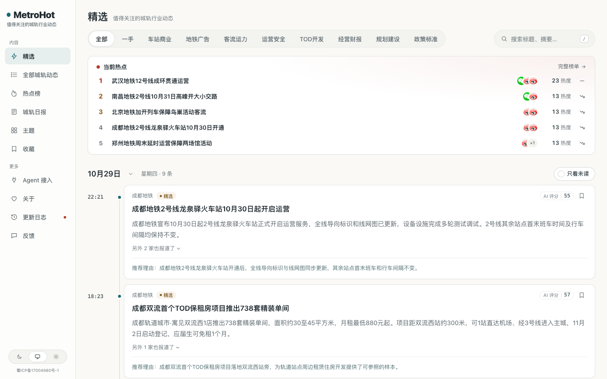
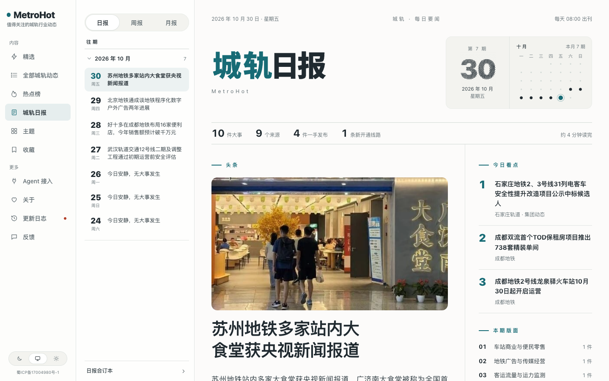
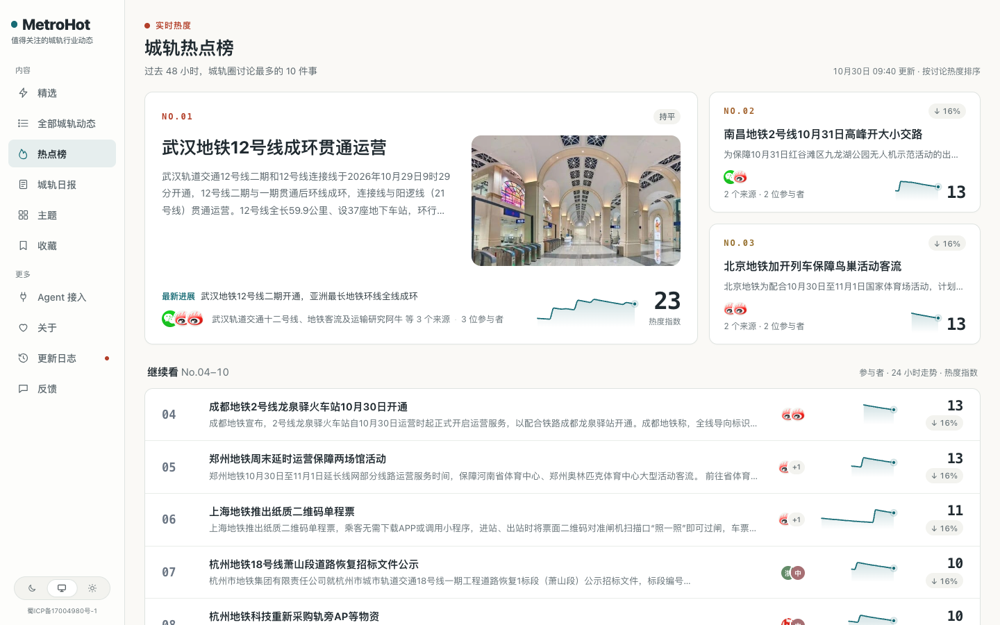
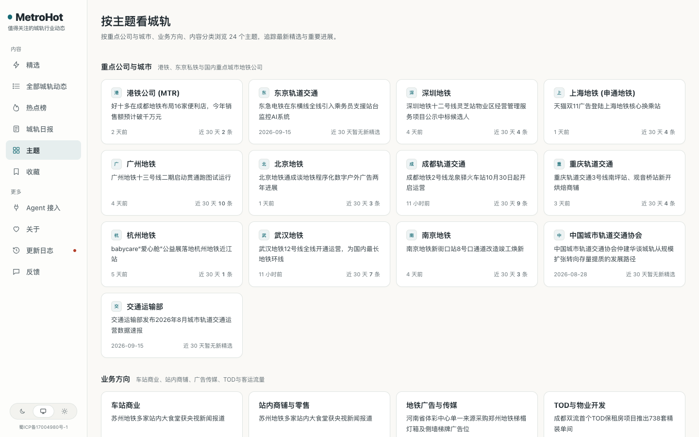

# MetroHot · 城轨行业动态

<p>
  <a href="https://metrohot.oohforce.com"></a>
  
  
  
  <a href="LICENSE"></a>
</p>

**MetroHot 是一个城市轨道交通（地铁）行业的热点聚合站。** 它每天盯住全国城轨行业的官方信源、招采公告、公众号与自媒体，把零散的动态收进来，用大模型筛选、写作、归组，每天 08:00 出一份读得完的城轨日报。

线上站点：<https://metrohot.oohforce.com>

<p align="center">
  
</p>


---

## 这是什么

城市轨道交通行业的信息很散：新线开通在发改委的批复里，招标在各地的公共资源交易平台，车站商业和广告招商在运营公司的公众号，客流数据在交通运输部的月报里，行业动态还散落在几十家地铁集团的官网和上百个公众号中。

MetroHot 把这些信源统一接进来，做四件事：

1. **采集**：RSS、网页列表、JSON 接口、X、微信公众号，以及外部脚本推送的自媒体数据；
2. **精选**：模型先判断是不是行业的事、有没有实际信息，再独立打两次分，按信源分级和类别门槛决定入选；
3. **归组**：把不同来源报道的同一件事聚成一个事件，按独立来源数算热度，后续进展挂在同一个事件下；
4. **出刊**：每天 08:00 出日报，每周一 10:00 出周报，每月 1 日 10:30 出月报（北京时间）。

所有提示词、评分标准和入选门槛都写在仓库里，改标准不需要改代码。

## 覆盖什么

站内的类别（也是 RSS 分类订阅和 API 分类的 key）：

| 类别 | 内容 |
|---|---|
| 车站商业 | 站厅与站台商铺租赁、站内便利店与便民餐饮、自动售卖、车站商业空间经营 |
| 地铁广告 | 车厢与站台广告、数字大屏、广播与车载电视的招商与特许经营 |
| 客流运力 | 交通运输部客运月报、城市单日客流新高、客运强度、运力投放与大客流保障 |
| 运营安全 | 运行图调整、行车调度、信号与无人驾驶升级、延误限流、防汛应急与故障处置 |
| TOD 开发 | 沿线与车辆段上盖物业、站城一体化项目、土地出让与规划、附属商业地产 |
| 经营财报 | 城轨集团年报与财务报表、票务与补贴收支、债务融资、人事与重组 |
| 规划建设 | 线网规划与工可批复、新线开工与贯通、轨通电通、空载试运行与开通运营 |
| 政策标准 | 交通运输部、国家铁路局、中城轨协的指导意见、管理规定、技术规范与团体标准 |

主题页另有 24 个专题（重点城市、港铁生态、TOD、车站商业、广告传媒、经营业务等），主体名录收录 51 个机构（城轨集团、运营公司、监管机构与产业链企业）。

## 信源

信源清单不随仓库发布（`industry/sources.json` 在 `.gitignore` 中，只留在部署环境）。当前线上站点配置了 **326 个信源**：

| 类型 | 数量 | 说明 |
|---|---|---|
| RSS | 199 | 地铁集团官网新闻、行业媒体、公众号 RSS |
| 网页列表 | 87 | 官网动态、招标采购与中标公示栏目 |
| JSON 接口 | 29 | 公共资源交易平台等结构化接口 |
| 微信公众号 | 6 | 经 [we-mp-rss](https://github.com/rachelos/we-mp-rss) 采集 |
| X 搜索 | 5 | 行业账号与关键词 |

此外，自媒体五平台（微博、抖音、小红书、B站、知乎）的采集结果通过 `scripts/ingest-mediacrawler.ts` 作为外部推送入库，这类数据不进 `sources.json`，由采集侧自行维护。

信源分三级（官方一手、官方账号与准官方、媒体与个人），各级门槛不同；抓取频率按近 7 天的产出自动调整，最快 15 分钟一次。

## 它是怎么工作的

```
信源 → 采集（判重、抓原文） → 判断与写作（预筛、评分、标题摘要、结构化）
     → 归组（事件、热度、综述） → 公开读取层 → 网页 / RSS / API / MCP / 日报周报月报
```

- **判重与归档**：发现时已发布超过 48 小时的旧文不进“今天”；
- **预筛**：判断是不是城轨行业的事、有没有实际信息，广告与无关内容在这一步拦掉；
- **评分**：同一份标准独立打两次分，按内容类型给五个维度不同权重，再按信源分级和类别门槛决定入选；
- **写作**：中文标题、答案先行的摘要、推荐理由；外文正文翻译；分类、标签和事实单独抽取；
- **归组**：用标题摘要向量在近两周内找候选，模型判断是同一件事（SAME_OCCURRENCE）、后续进展（SAME_STORY）还是两件事（UNRELATED）；
- **热度**：按事件算，48 小时内每个独立来源只算一次，24 小时减半；
- **出刊**：日报按规则编出当天要闻，不调模型；周报、月报从日报里汇编。

每一步的提示词在 [`industry/prompts/`](industry/prompts/)，类别与主体名录在 [`industry/taxonomy.ts`](industry/taxonomy.ts)，入选门槛在 [`industry/selection.ts`](industry/selection.ts)。

## 你会得到什么

| | |
|---|---|
| **精选** | 预筛 + 两次独立评分，同一条新闻只占一个席位，换说法的重复不进 |
| **事件与热度** | 不同来源的同一件事聚成一个事件，事件页有综述与时间线；热度按独立来源算 |
| **日报、周报、月报** | 每天 08:00 日报，每周一 10:00 周报，每月 1 日 10:30 月报 |
| **主题与搜索** | 24 个专题；标题摘要搜索与全文相关搜索 |
| **给 Agent 用** | RSS（精选、全部、全文、日报、周报、月报、分类）、公开 API、MCP、Agent Markdown、`llms.txt` |
| **后台** | 信源管理与试抓、内容诊断与人工评分更正、精选评测、逐步换模型、预算熔断、运行记录与告警 |

### 公开出口

| 地址 | 内容 |
|---|---|
| `/` `/all` `/hot` `/topics` `/daily` `/weekly` `/monthly` | 精选、全部动态、热点榜、主题、日报周报月报 |
| `/feed.xml` `/feed/all.xml` `/feed/daily.xml` 等 | RSS：精选、全部、日报、周报、月报，以及按分类的订阅 |
| `/api/v1/` · `/openapi-v1.json` | 公开 API，匿名只读，无需 Key |
| `/api/mcp` | MCP 服务，工具名前缀 `metrohot_` |
| `/llms.txt` · `/sitemap.xml` · `/agent` | 给大模型和搜索引擎的说明与接入指引 |

公开内容匿名，管理员与访客看到的一致；站内默认只展示摘要和原文链接，全文展示由信源的 `site_fulltext` 决定。

## 看一眼

| 城轨日报 | 热点榜 |
|---|---|
|  |  |

主题页按公司与城市、业务方向列出 24 个专题：



## 技术栈

Node.js 24（直接运行 TypeScript，后端无构建步骤）· React Router 服务端渲染 · Fastify · PostgreSQL 17 · pg-boss · Tailwind CSS · Docker Compose。

三个进程：`apps/api`（接口、RSS、MCP、图片代理）、`apps/worker`（采集、模型任务、归组、出刊）、`apps/web`（服务端渲染页面，只通过 HTTP 读 api）。

```
apps/       三个进程
packages/   业务代码（backend）、共享类型（contracts）
site/       站名文案、每一步的模型、品牌、条款页、更新日志
industry/   分类标签、主题、信源、提示词、门槛
modules/    只有本站需要的功能（目前没有）
database/   数据库迁移
scripts/    初始化、迁移、种子、评测、采集辅助
tests/      后端测试
```

## 本地运行

需要 Docker、Node.js 24，以及一个 OpenAI 兼容的模型 API Key。

```bash
node scripts/init-env.ts --llm-key <你的模型 API Key>
docker compose up -d --build
```

打开 <http://localhost:3000>，后台在 `/admin`，管理员密码在 `.env` 的 `ADMIN_PASSWORD` 里。第一次导入的资料大约半小时处理完。

新克隆的仓库不带信源清单（`industry/sources.json` 不随仓库发布），站点起来后是空的，在后台“信源”页逐个添加，或按 [`industry/README.md`](industry/README.md) 的格式自备一份再跑 `node scripts/seed.ts`。

开发时请保持 `COLLECT_ENABLED`、`MODEL_CALLS_ENABLED` 与各推送开关关闭，测试只连本地假服务，不访问外部站点。

## 与上游框架的关系

MetroHot 基于开源框架 [AIHOT](https://github.com/KKKKhazix/AIHOT)（MIT）定制：引擎、后台、精选流程、归组与出刊都来自上游，本站做的是行业化——类别标签、主题、326 个信源、提示词与门槛、站点文案与品牌，以及公众号与自媒体采集链路的接入。

上游更新会定期合并进 `main`，合并方式见 [CONTRIBUTING.md](CONTRIBUTING.md)。本站自己的改动集中在 `site/`、`industry/` 与少量上游不含的采集适配，尽量不改 `apps/` 与 `packages/`，以便持续跟进上游。

## 说明

- 本站是聚合摘要与阅读索引，原文版权归各来源所有；如果你是来源方，希望更正、下架或调整展示方式，请通过站内反馈页联系我们。
- 部署脚本、服务器运行手册与内部运维文档不随仓库发布。
- 站点备案：蜀ICP备17004980号-1。

## 许可

代码使用 [MIT 许可证](LICENSE)。AIHOT 的名字与 Logo 不在许可范围内；本站不使用上游品牌。
